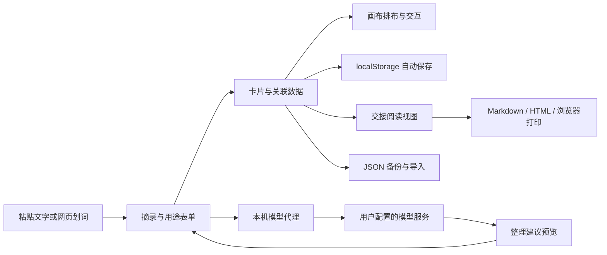

# Canvas Coworker · MVP版

把 AI 对话中的有用片段，整理成同事能快速理解、继续推进的交接材料。

Canvas Coworker 面向频繁使用 AI 的产品、设计、开发与运营工作者。用户摘录一段对话，补充“这段内容对什么工作有用”，再通过画布组织关系，生成包含原文、用途、出处和下一步的交接简报。

应用独立位于 [coworker](coworker/) 目录，采用原生 JavaScript、HTML、CSS 与 Node.js 构建。基础操作在本地完成，AI 提炼通过用户配置的兼容模型服务接入。

## 快速开始

使用 Node.js 24.15 或更新的 24 版本，也支持 Node.js 26 及以上版本。当前开发环境为 Node.js 24.16。

在仓库根目录运行：

```powershell
npm --prefix coworker start
```

打开 [http://127.0.0.1:4173](http://127.0.0.1:4173)。启动与基础使用直接依赖 Node.js 内置能力，无需安装应用依赖或填写 API key。

Windows 用户可以双击 [start-coworker.cmd](start-coworker.cmd)。脚本进入应用目录并启动本地服务，关闭窗口即可停止服务。

首次打开会加载包含 6 张卡片与示例关联的工作画布。点击左侧“工作画布”旁的加号，可以建立自己的画布。小屏幕上的“更多操作”入口提供画布切换、新建、备份、导入与 AI 设置。

如需更换端口，在应用目录执行：

```powershell
$env:PORT=4174
npm start
```

浏览器存储按访问地址隔离。跨地址或端口迁移时，可以通过 JSON 备份与导入携带工作内容。

## 功能

| 功能 | 具体操作 |
| --- | --- |
| 对话摘录 | 粘贴 AI 回答、方案或参考文字，建立独立卡片 |
| 用途批注 | 记录这段内容适合什么需求、功能、技术方案或团队讨论 |
| 卡片编辑 | 编辑标题、原文、用途、来源名称、原始链接、对接人、下一步与完成状态 |
| 网页划词收集 | 通过浏览器书签读取网页选中文字、页面标题和地址，带入摘录表单，确认后保存 |
| 自动标题 | 根据用途说明或摘录内容生成短标题，也可自行填写 |
| 本地分类 | 根据用途说明中的关键词推荐分类；用途为空时分析原文 |
| 用途分类 | 产品启发、技术方案、行动待办、待整理四类，支持手动指定 |
| 自动排布 | 按现有用途分类分列，同类卡片纵向排列，保留正文与关联 |
| 自由画布 | 拖动卡片调整位置，拖动空白平移，缩放画布，一键适应全部可见内容 |
| 位置反馈 | 新增或编辑保存后将卡片定位到可见区域，并突出选中 |
| 关系组织 | Shift 多选两张卡片建立关联，支持解除选中卡片的关联 |
| 搜索与筛选 | 搜索标题、原文、用途、来源、对接人和下一步，结合用途分类筛选 |
| 工作推进 | 为卡片填写对接人与下一步，标记完成并在画布与交接简报中显示状态 |
| 多画布管理 | 新建、切换画布，修改画布名称与背景说明，分别保存卡片与关联 |
| 交接阅读视图 | 按用途生成简报，集中呈现用途、原始摘录、来源、对接人、状态、下一步与关联 |
| 局部交接 | 为整个画布或选中的卡片生成交接材料 |
| Markdown 交接 | 复制 Markdown，或下载为 `.md` 文件，便于放入团队文档 |
| 网页交接 | 下载包含内嵌样式的独立 HTML 文件，同事可直接在浏览器阅读 |
| 打印与 PDF | 在交接视图调用浏览器打印，选择打印机或保存为 PDF |
| 自动保存 | 将工作空间保存到当前浏览器，刷新后恢复画布、卡片、位置与关联 |
| 撤销与重做 | 保存最近 30 步操作记录，支持恢复编辑、移动、删除及关联操作 |
| JSON 备份 | 将全部工作画布、卡片与关系导出为可迁移文件 |
| 安全导入 | 校验备份结构，生成新的画布与卡片 ID，重建关联，追加到现有工作空间 |
| 同浏览器标签页更新 | 空闲页面接收其他标签页的存储变化；编辑期间检测变化并阻止旧数据覆盖 |
| 存储异常处理 | 保存异常时显示提示；原数据无法读取时保留原始内容，并提供原始数据下载入口 |
| AI 整理建议 | 根据当前摘录与用途提炼标题、分类、用途说明和下一步，预览后手动应用 |
| 操作辅助 | 内置使用说明、快捷键提示、移动屏幕适配与表单错误反馈 |

### 网页划词收集

打开“网页划词收集”，将“收集到 Coworker”拖到独立浏览器的书签栏。保持本地服务运行，在普通网页中选中文字后点击书签。

书签将选中文字、网页标题与地址编码到本地页面的 URL fragment，应用读取后打开填写窗口，并移除地址栏中的摘录内容。用户可以补充用途、对接人与下一步，再确认保存。

这一入口由浏览器书签脚本触发。网页允许脚本执行时可以直接划词收集，也可以随时复制原文后通过“添加摘录”进入相同流程。

### 操作方式

| 操作 | 方式 |
| --- | --- |
| 新增摘录 | 点击“收集一段灵感”或“添加摘录”，也可按 `N` |
| 编辑卡片 | 双击卡片、点击卡片右上角按钮，或聚焦卡片后按 Enter |
| 选择卡片 | 点击卡片，按住 Shift 追加选择 |
| 关联卡片 | 选择两张卡片，点击“关联两张卡” |
| 清除选中 | 点击画布空白、选中工具条的关闭按钮，或按 Esc |
| 搜索 | 点击搜索框或按 `/` |
| 平移 | 拖动画布空白，或使用滚轮 |
| 缩放 | 使用右下角加减按钮，或按住 Ctrl 使用滚轮 |
| 自动排布 | 点击“按用途排布” |
| 查看全局 | 点击右下角“适应画布” |
| 撤销与重做 | 使用右下角按钮，或按 `Ctrl+Z`、`Ctrl+Shift+Z` |
| 生成交接 | 点击“生成交接简报”“交接视图”，或“交接选中内容” |

## 使用场景

| 场景 | 可以组织的内容 |
| --- | --- |
| 产品与需求讨论 | 有启发的 AI 回答、适用需求、自己的判断、需要推进的设计 |
| 设计交接 | 交互思路、体验问题、改版依据、对接人与下一步 |
| 技术方案交流 | 实现方案、适用条件、原始上下文、验证安排与相关方案 |
| AI 达人与电商运营 | 选题依据、内容思路、链路优化、需要对接的团队角色 |
| 工作进展交接 | 已完成事项、关键信息、相关出处、后续工作安排 |

例如，从 Codex 复制一段缓存策略，补充：“这个方案适合视频生成接口，想请开发同事验证缓存失效条件。”将它归入技术方案，填写对接人与下一步，与验证任务关联，再导出交接简报。接收者可以同时看到使用理由、技术原话、来源和行动安排。

## 技术架构

应用采用“浏览器工作空间 + 本机 HTTP 服务 + 可选模型服务”的结构。卡片操作和文件交接由浏览器完成，本机服务提供页面与模型请求转发。



| 层次 | 技术 | 职责 |
| --- | --- | --- |
| 页面与表单 | HTML、原生 DOM、`dialog` | 摘录填写、画布管理、模型设置、帮助与简报 |
| 界面样式 | CSS、Grid、Flex、媒体查询 | 工作区布局、用途配色、响应式适配、打印样式 |
| 画布交互 | JavaScript、Pointer Events、CSS transform | 卡片拖动、平移缩放、选中与视图定位 |
| 关联绘制 | SVG、贝塞尔曲线 | 根据卡片位置绘制关系线并随移动更新 |
| 业务数据 | ES Modules、结构校验函数 | 分类、布局、备份合并、导出和模型响应校验 |
| 本地存储 | localStorage、`storage` 事件 | 自动保存、恢复与同浏览器标签页变化处理 |
| 文件交接 | Blob、Object URL、Clipboard API | JSON、Markdown、独立 HTML 导出及文本复制 |
| 本机服务 | Node.js `http`、`fs/promises` | 提供静态资源和模型整理接口 |
| 模型连接 | Node.js `fetch`、Chat Completions 协议 | 转发当前摘录，解析和校验建议结果 |
| 自动化检查 | `node:test`、`node:assert`、jsdom | 数据、接口、页面操作与异常路径验证 |

### 模块划分

```text
coworker/
├── public/
│   ├── index.html             页面、表单和交接视图入口
│   ├── styles.css             画布、卡片、响应式与打印样式
│   ├── app.js                 交互、存储、历史操作和 AI 建议流程
│   ├── core.mjs               数据模型、分类、排布、导入与导出
│   └── favicon.svg            应用图标
├── tests/
│   ├── core.test.mjs          业务数据和 HTTP 接口测试
│   └── interaction.test.mjs   模拟页面交互测试
├── server.mjs                 本机 HTTP 服务与模型代理
├── package.json               启动、测试和语法检查命令
├── package-lock.json          开发依赖版本锁定
└── AGENTS.md                  当前应用的开发约定
```

前后端共享 `core.mjs` 中的模型建议校验逻辑。数据处理与界面事件分开，便于单独验证分类、备份、关联和导出行为。

### 数据与画布方案

工作空间以 JSON 组织，包含当前画布 ID 与画布列表。每张画布保存名称、背景、卡片集合和关联集合。

| 对象 | 主要字段 |
| --- | --- |
| 工作空间 | `version`、`activeProjectId`、`projects` |
| 画布 | `id`、`name`、`description`、`cards`、`edges` |
| 卡片 | `id`、`title`、`quote`、`intent`、`category`、`source`、`sourceUrl`、`owner`、`nextStep`、`status`、`x`、`y`、`createdAt` |
| 关联 | `id`、`from`、`to` |

原始摘录 `quote` 与用途说明 `intent` 分别保存。模型建议只提炼标题、用途、分类和下一步，应用建议时保留原文。

卡片保存世界坐标，视图单独维护平移量与缩放比例。拖动时根据当前缩放换算坐标，更新卡片与 SVG 连线；排布时按分类设置列位置，并在列内纵向排列。画布显示空间随内容范围扩展。

本地分类使用关键词计分，优先参考用户填写的用途。自动标题从用途说明或原文中截取，用户可以继续编辑。规则整理和位置排布均在浏览器内完成。

### 保存、历史与迁移

工作空间保存在 `canvas-coworker.workspace.v1`。每次数据变更后写入浏览器存储，重新打开时校验并恢复。界面显示保存状态，存储异常时提供提示和备份路径。

撤销与重做使用工作空间快照。一次编辑、移动、删除、排布或关联操作对应一条历史记录，支持最近 30 步操作。

JSON 导入先检查版本、画布结构和卡片内容，再为导入对象生成新 ID，并同步映射关联的两端。导入结果追加为新画布，保留现有工作内容。校验过程中也会清理无效链接、悬空关联、重复关联和自关联。

文件导入上限为 4 MiB，工作空间支持最多 50 个画布、1000 张卡片，每张画布支持最多 3000 条关联。

同一浏览器的其他标签页发生存储变化时，空闲页面会接收更新。正在填写表单或拖动卡片的页面会提示数据冲突并阻止覆盖，便于先保存手头内容。

### 交接材料生成

交接内容直接由保存的卡片和关联生成，按产品启发、技术方案、行动待办和待整理分组。整个画布与选中内容使用相同的输出逻辑。

Markdown 保留用途、引用原文、来源链接、对接人、状态、下一步和关联标题；独立 HTML 内嵌阅读与打印样式，并对用户文字进行转义。页面交接视图使用同一批保存数据，可以展开原始摘录、查看出处或调用浏览器打印。

## 模型接入方案

点击左下角“AI 整理设置”，填写兼容模型服务的信息：

| 配置 | 说明 |
| --- | --- |
| 服务地址 | 兼容服务的 Base URL，例如以 `/v1` 结尾的地址；也支持完整的 `/chat/completions` 地址 |
| 模型名称 | 服务提供方支持的模型 ID |
| API key | 用户自己的服务密钥；本机免鉴权服务可以留空 |

模型服务使用 HTTPS，本机模型地址支持 HTTP。服务地址和模型名保存在 `canvas-coworker.model.v1`；密钥仅保留在当前页面内存中，页面刷新后重新填写。

点击“AI 提炼建议”后，浏览器将当前原文和用途说明发送到本机 `POST /api/organize`。本机服务构造 system/user 消息，并通过兼容的 Chat Completions 接口转发。用户配置的地址决定请求接收方。

模型返回 JSON 建议：

```json
{
  "title": "为视频生成接口增加缓存",
  "category": "solution",
  "intent": "用于接口方案评审，讨论缓存命中与失效条件。",
  "nextStep": "补充缓存失效策略并安排验证。"
}
```

分类字段使用 `idea`、`solution`、`action` 或 `inbox`。服务端与前端校验字段后显示建议，用户点击“应用建议”将内容填入表单，再保存到画布。原文或用途在等待过程中发生变化时，旧建议会被拦截，避免覆盖新的输入。

接口请求结构参考 [OpenAI 官方文档](https://developers.openai.com/api/reference/python/resources/chat/subresources/completions/methods/create)。模型需支持 system/user 消息，并按提示返回 JSON 文本。

### 本机接口与请求处理

| 接口 | 用途 |
| --- | --- |
| `GET /`、`GET /index.html` | 工作区页面 |
| `GET /app.js`、`GET /core.mjs` | 页面交互与业务模块 |
| `GET /styles.css`、`GET /favicon.svg` | 样式与图标 |
| `POST /api/organize` | 整理当前摘录与用途说明 |

本机服务监听 `127.0.0.1`，静态资源按明确的路径表提供。模型接口检查请求方法、来源、内容类型与应用请求头；上游请求携带用户配置的鉴权信息，禁止跟随重定向，并设置 45 秒超时。

原始摘录输入上限为 16000 个字符，模型代理请求体上限为 128 KiB。服务端处理鉴权错误、网络异常、超时、无效 JSON 与无效分类，并向界面返回可读的提示。API 响应设置 `Cache-Control: no-store`，密钥不写入工作空间与导出文件。

## 开发与验证

在应用目录安装开发依赖并运行检查：

```powershell
cd coworker
npm ci
npm test
npm run check
```

`npm start` 启动应用；`npm test` 使用 Node.js 内置测试运行器；`npm run check` 检查服务端和前端模块语法。jsdom 用于开发阶段的模拟页面测试，应用运行时使用浏览器能力与 Node.js 内置模块。

当前共 21 项自动化测试，覆盖原文与用途分别保存、分类与排布、备份合并、关联映射、交接范围与文字转义、模型结果校验、本机 HTTP 接口、页面新增编辑、拖动撤销、刷新恢复、导入错误处理、划词表单、AI 建议确认、过期建议处理以及存储异常保护。

接口测试使用本地模拟模型服务，检查请求内容、建议返回、鉴权失败、格式错误和重定向处理。模拟页面测试依据 [jsdom 官方文档](https://github.com/jsdom/jsdom)，执行当前应用的交互脚本。

## 仓库与来源

项目仓库：[Jinkeen/Canvas-Coworker](https://github.com/Jinkeen/Canvas-Coworker)。

当前独立应用位于 `coworker/`，本地开发分支为 `codex/coworker-mvp`，版本名为“MVP版”。仓库根目录的 [README](README.md) 提供完整使用与技术说明，[coworker/AGENTS.md](coworker/AGENTS.md) 记录当前应用的模块与开发约定。

仓库保留此前引入的 [Canvas Chat](https://github.com/ericmjl/canvas-chat) 历史源码与文档。根目录的 Python 配置、`src/`、`tests/` 与相关历史资料保留其原有来源与许可信息；独立应用通过 `coworker/` 中的 Node.js 入口运行。
